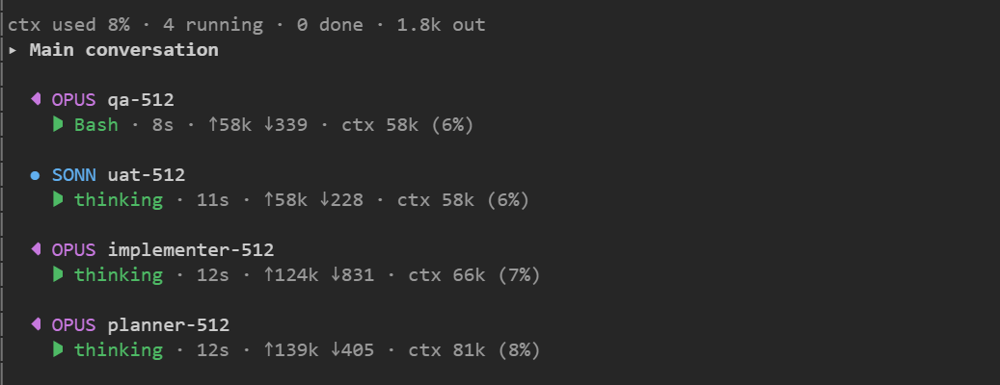
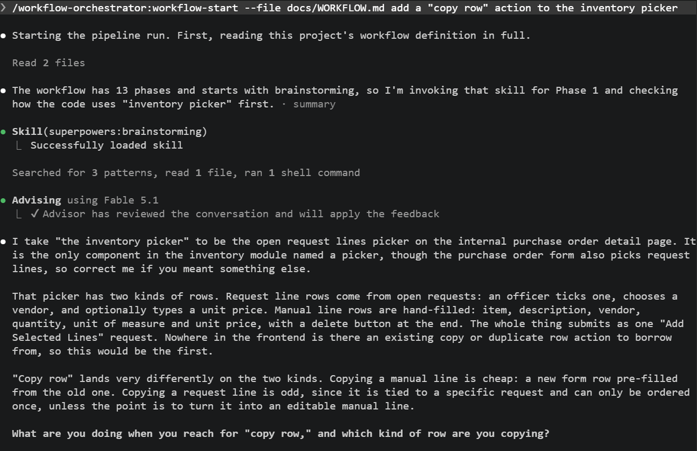
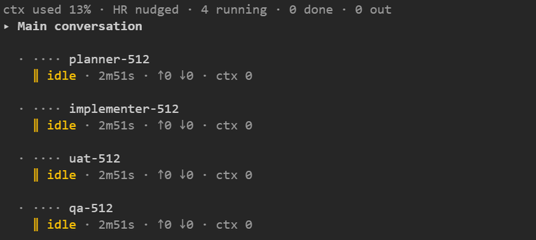
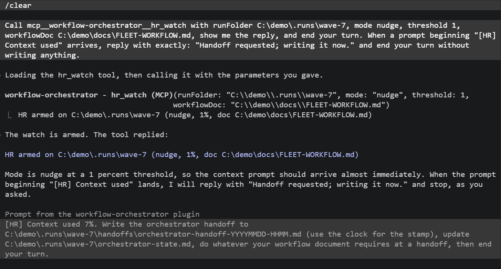
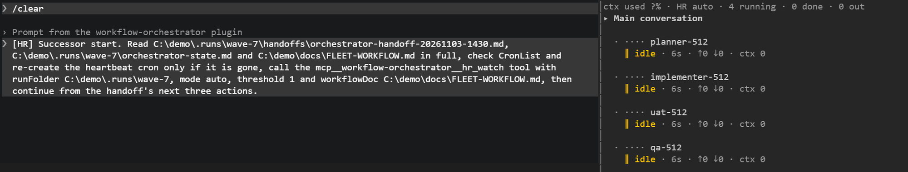

# workflow-orchestrator

A Claude Code plugin for running complicated workflows in long-running Claude Code sessions.

```text
/plugin marketplace add chrisghughes-alt/workflow-orchestrator
/plugin install workflow-orchestrator
```

It does two things:

- **Agent management views.** A side pane that lists every background agent with its model, what it is
  doing, how long it has run, its tokens and its context. It appears by itself, with no setup.
- **Pipeline enforcement.** A skill that drives your repository's `docs/WORKFLOW.md` phase by phase, and
  will not move on until each phase has produced its output and cleared its gate.

You can use either one alone, or both together. A third part, the context watch, keeps a long-running
session going across context resets; see [HR for AI](#hr-for-ai--context-cycling-without-losing-the-thread).

## Agent management views

Install the plugin and start any background agent. The Agents pane opens by itself the first time a
background agent appears. It never opens at session start, and `/agent-sidebar` opens it on demand.



Each row shows:

- the agent's model as a glyph, a text tag and a colour, so you never have to tell models apart by
  colour alone;
- what the agent is doing now, and how long it has run;
- tokens in and out, and its context size;
- `⚠ silent` and the quiet time, once a running agent has gone ten minutes with no model request or
  tool call.

Click a row to view that agent. The header shows `ctx used N%`, the share of the main session's context
window in use, and the state of the context watch when it is armed.

The model can read the same roster through a tool:

| Tool | What it does |
|---|---|
| `mcp__workflow-orchestrator__agents` | Returns the roster as JSON: one row per agent with name, model, status, activity, tokens in and out, context size and timestamps. |

## Pipeline enforcement

The `workflow-start` skill reads your project's `docs/WORKFLOW.md` and drives its phases in order. You
call it like a command:

```text
/workflow-start add a CSV export to the reports page
```

For each phase, the engine reads the phase's **Orchestrator directives** and runs this loop:
`Condition → Pre → Invoke → Suppress → Post → Output → Gate → Route`. Four rules hold throughout:

1. Phases run in the order the workflow defines.
2. A phase that declares an output must produce it before the engine moves on.
3. A consent gate needs an explicit yes. "Looks good" is not consent.
4. When an invoked skill tries to decide what happens next, the engine's plan wins and control comes
   back to it.



The engine knows nothing about any one project. Your `docs/WORKFLOW.md` names the phases, the skills
they invoke, the files they produce and the gates they enforce. The plugin supplies only the discipline
to run that pipeline faithfully.

**Why "orchestrator".** A phase can invoke any command, skill or agent you already use, so you can chain
them into one master workflow. The engine holds that chain together: each invoked piece does its job and
hands control back, instead of deciding what happens next and running off with your pipeline. The
examples show this best.

### Getting a workflow

You rarely need to start from a blank page. There are three ways in, and none of them invents a pipeline
silently or borrows another project's phases:

- **Capture a session.** Run `/workflow-capture` at the end of a session you would want to repeat. It
  reviews the session and proposes the phases, what each invoked, what it produced and where approvals
  happened. It can also read your `CLAUDE.md`, `docs/` and Claude memories so the result matches your
  real conventions. It then walks you through each phase so you confirm or edit its `Invoke`, `Output`,
  `Gate` and `Route`, and only then writes a runnable `docs/WORKFLOW.md`. It works even on a run you
  drove by hand without `/workflow-start`.
- **Let the engine scaffold one.** Run `/workflow-start` in a project with no `docs/WORKFLOW.md`, and it
  offers to write a starter for you to customize.
- **Copy an example.** Start from [`examples/minimal-WORKFLOW.md`](examples/minimal-WORKFLOW.md). The
  [`examples/`](examples/) folder also holds a compact 5-phase pipeline, an elaborate 13-phase pipeline
  (both real and sanitized), and a fleet template for named background agents.

### Several workflows in one project

The default file is `docs/WORKFLOW.md`. Name extra workflows `docs/<slug>-WORKFLOW.md` and pick one with
a leading `--file` argument:

```text
/workflow-start --file docs/release-WORKFLOW.md cut the release
```

### Keeping the workflow in step with how you work

If you force changes during a run, such as skipping a phase, reordering, or overriding a gate, the engine
offers at the end to fold them back into the workflow file. Small drift gets a one-line note. Bigger
friction gets a short prompt: update inline, hand off to `/workflow-capture`, or dismiss. A clean run
says nothing.

## HR for AI — context cycling without losing the thread

A long-running orchestrator fills its context. Automatic compaction then blurs what it knew. A handoff
written to disk, followed by a fresh context that reads it, keeps the thread better. The context watch
(shown as "HR" in the pane header) does that for you.

The watch is off until armed, and it watches only the session that armed it.

**How it works.** Arm it with the `hr_watch` tool or the `/hr-watch` command, giving it the run folder.
When the main session reaches the threshold, the watch submits one nudge. The nudge asks the model to
write a handoff file to `<run folder>/handoffs/orchestrator-handoff-YYYYMMDD-HHMM.md`, update
`<run folder>/orchestrator-state.md`, do whatever the workflow document requires at a handoff, and end
its turn.





When a new handoff file appears after that turn, the mode decides what happens next:

- **`nudge`, the default.** The header shows `HR ready`. You run `/clear` and then the resume prompt
  when you are ready. Use this when you are at the keyboard and want to read the handoff first.
- **`auto`.** The plugin runs `/clear` itself and submits a resume prompt. The prompt names the handoff
  file, the run-state file and the workflow document. It tells the new context to re-create the
  heartbeat cron only if it is gone, to call `hr_watch` again with the same arguments, and to continue
  from the handoff's "Next three actions". Without a workflow document, the prompt points at the
  "how to resume" section of the run-state file instead. Use this for a long run with nobody at the
  keyboard.



### What `/clear` keeps and what it resets

| `/clear` keeps | `/clear` resets |
|---|---|
| The session's background agents. They keep their names and still answer `SendMessage`. | The plugin's own stored state: the watch's settings and the roster's counters. |
| The session's crons. | |
| The roster in the pane. | |

In `auto` mode the plugin writes the watch back right after its own clear. After a `/clear` you run in
`nudge` mode, the watch stays off. Either way, the new context's `hr_watch` call arms it again with the
same arguments.

### Tools and commands

| Tool or command | What it does |
|---|---|
| `mcp__workflow-orchestrator__hr_watch({ runFolder, mode?, threshold?, workflowDoc? })` | Arms the watch. `runFolder` is the run folder. `mode` is `nudge` (default) or `auto`. `threshold` is the percent of context used, a whole number from 1 to 100, default 50. `workflowDoc` is the workflow document the new context should read. |
| `mcp__workflow-orchestrator__hr_off()` | Turns the watch off. |
| `/hr-watch <folder> [nudge\|auto] [key=value …]` | Arms the watch from the prompt. The keys are `mode`, `threshold` and `doc`. A bare threshold right after the mode word also works. |
| `/hr-off` | Turns the watch off. |
| `/agent-sidebar` | Opens the Agents pane. |

Paths must be absolute and must exist. A path over 1024 characters or with control characters in it is
refused, and the watch stays as it was. Give the folder to `/hr-watch` without quotes; spaces in it are
fine. For example:

```text
/hr-watch /path/to/repo/.runs/my-run mode=auto doc=/path/to/repo/docs/my-fleet-WORKFLOW.md
```

The reply always states the mode and threshold, for example `HR armed on <folder> (nudge, 50%)`.

## Together: running a workflow across a fleet

The two halves and the watch fit together. The main session acts as the orchestrator. It starts named
role agents with Claude Code's own `Agent` tool, for example
`Agent({ name: 'planner-42', model: 'opus', subagent_type: 'general-purpose', prompt: '<path to brief>' })`.
The pane is your window onto them. The watch keeps the orchestrator going across context resets, and a
background agent can run the engine through its Skill tool.

[`examples/Native-Agent-Fleet-WORKFLOW.md`](examples/Native-Agent-Fleet-WORKFLOW.md) is a complete fleet
workflow that does all of this. Each part your repository supplies, such as its methodology document,
item tracker, naming, review chain and gates, is marked with a `<slot: …>` placeholder.

### What a repo must provide

1. **A run folder for each run**, inside the repository and ignored by git, so any later session finds
   it by path:

   ```text
   <repo>/.runs/<run-name>/
     orchestrator-state.md   the run-state file: every ruling, dispatch and verification, as it happens
     briefs/                 one brief file per agent
     reports/                every report an agent writes
     handoffs/               orchestrator and agent handoff files
   ```

2. **A handoff shape** that ends with a section headed **Next three actions**. The new context continues
   from it.
3. **A workflow document** the new context reads in full after a handoff, passed as `workflowDoc`.
4. **Arming at kickoff.** The orchestrator calls `hr_watch` with the run folder, the mode and the
   workflow document when a run starts, and calls `hr_off` when it ends.

### Limits of named agents

These were measured, not assumed:

- Only the main session can start named agents. A named agent that tries to start another is refused, so
  the roster is flat.
- A named agent has no `ListAgents` tool and no `AskUserQuestion` tool. Questions for the person go
  through the main session.
- A named agent's own helpers are unnamed and run in the foreground. The agent waits for each one.
- The session's permission mode and plan mode apply to every agent in the tree.
- A background agent can call skills but not plugin commands. That is why the engine is the
  `workflow-orchestrator:workflow-start` skill rather than a command.

## Install

```text
/plugin marketplace add chrisghughes-alt/workflow-orchestrator
/plugin install workflow-orchestrator
```

On Claude Code 2.1.275 or later, one line does both:

```text
/plugin install workflow-orchestrator --marketplace chrisghughes-alt/workflow-orchestrator
```

## Loading the plugin

- **Subscribers** install from this marketplace, as above, and update through `/plugin`.
- **Developers** working on a local clone point the `CLAUDE_CODE_PLUGIN_DIRS` environment variable at
  the clone, which reloads the plugin as files change. While doing that, disable the installed copy,
  through `/plugin` or its entry in your settings' `enabledPlugins`.

Never load both at once. Both copies would register the same commands, tools and pane, and you would see
each one twice.

## Writing your pipeline

[`docs/authoring-workflows.md`](docs/authoring-workflows.md) covers the directive fields, gates and
routing. [`examples/README.md`](examples/README.md) explains which example to start from.

## Contributing

- **Version in two places.** A release bumps the version in both `.claude-plugin/plugin.json` and
  `.claude-plugin/marketplace.json`, and adds a `CHANGELOG.md` entry.
- **Examples stay sanitized.** The examples must never contain organization names, confidential details,
  or absolute internal paths. Private or custom skill names are marked as examples.
- **The engine is self-contained.** `skills/workflow-start/SKILL.md` must not depend on anything outside
  the target project. It reads the target project's workflow file at runtime and never hard-codes another
  project's phases.

## What's in the box

```text
.claude-plugin/   plugin and marketplace manifests
skills/           the workflow-start engine, a skill you invoke as /workflow-start and agents can call
commands/         the /workflow-capture authoring command
hooks/            the Agents pane, the context gauge, the context watch, and the three tools
types/            type definitions for the plugin's hooks module
tests/            tests for the hooks module
docs/             the authoring guide and the README images
examples/         a minimal pipeline, two real sanitized pipelines, and the fleet template
```

## Related

Custom agents to compose into your pipeline (the `quality-agents:*` references in the examples come from
here): **[chrisghughes-alt/ClaudeCodeAgents](https://github.com/chrisghughes-alt/ClaudeCodeAgents)**.

## License

[MIT](LICENSE)
